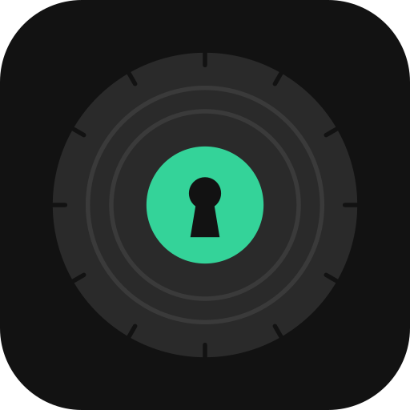
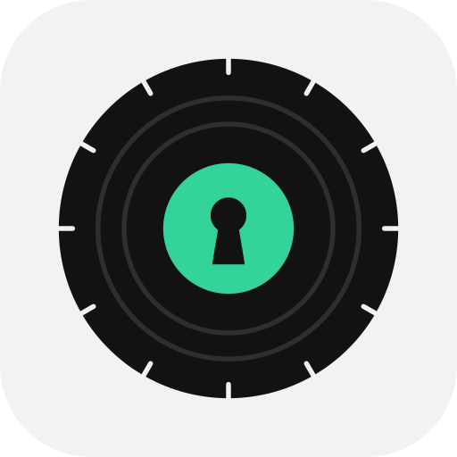

# spotibackup logo

 

The logo is the **vinyl vault**: a record drawn as a safe dial. A keyhole sits in the green label, and 12 short notches are cut into the rim like the ticks on a combination dial. It says "your music, locked away safely".

## Files

All files are generated by [`make_logo.py`](make_logo.py). Edit the script, not the SVGs, then run:

```bash
python3 docs/brand/make_logo.py
```

| File | Use | Detail |
| --- | --- | --- |
| [`logo.svg`](logo.svg) | Master. App icon, README, Docker Hub, UGOS app list, anything shown at 64 px or larger. | 12 notches, two grooves |
| [`logo-light.svg`](logo-light.svg) | The master on light surfaces. | Black record on a light tile |
| [`logo-64.svg`](logo-64.svg) | Shown at about 40–64 px. | 8 notches, one groove |
| [`logo-32.svg`](logo-32.svg) | Shown at about 20–40 px: the web UI sidebar and wizard header, the 32 px favicon. | No notches or grooves |
| [`logo-16.svg`](logo-16.svg) | 16 px favicon. | Larger label and keyhole so they survive |
| [`mark.svg`](mark.svg) | The record alone, with no tile, to place on a surface. The notches are see-through. | Same as the master |

In Pencil, the same sizes are reusable components in [`ui-design/spotibackup.pen`](../ui-design/spotibackup.pen), under **Components → BRAND**: `Logo/Mark`, `Logo/Mark Light`, `Logo/Mark 64`, `Logo/Mark 32` and `Logo/Mark 16`. The sidebar and the setup wizard header use `Logo/Mark 32`. [`add_logo_to_pen.py`](add_logo_to_pen.py) adds these components to a `.pen` file and swaps out the old placeholder marks. Close the file in Pencil before you run it.

## Construction

Drawn in a 140 × 140 box centred on the record, all as fills (no strokes):

| Part | Geometry | Colour |
| --- | --- | --- |
| Tile | 140 × 140, corner radius 28 | `#121212` |
| Record | Circle, radius 52 | `#2A2A2A` |
| Rim notches | 12, every 30°, starting at 12 o'clock. 1.5 wide, cut from the rim in to a round end at radius 47. They're holes, so they show whatever is behind the record. | Tile colour |
| Grooves | Rings at radius 40 and 32, 1.5 wide | `#3A3A3A` |
| Label | Circle, radius 20 | `#34D399` |
| Keyhole | Round head, radius 5.5, centred 4 above the middle; a slot that widens from 6 to 10 and ends 11 below the middle | `#121212` |

Light tile: tile `#F2F2F2`, record `#121212`, grooves `#2E2E2E`. The label and keyhole stay the same.

## Rules

- **Fixed colours.** The logo's colours aren't tied to the UI tokens. The label green `#34D399` is deliberately not the UI's `accent` token, so the logo stays our own and doesn't change if the accent does.
- **Pick the variant by size.** Don't scale the master below 64 px or a small variant up: smaller sizes drop detail on purpose.
- **Don't** recolour it, add the green to the notches, put the dial ticks outside the record, rotate it, or add effects.
- **Wordmark.** Next to the mark, "spotibackup" is set in Figtree 800, lowercase, as in the sidebar.
- **Not Spotify's.** No Spotify asset or shape is used. Keep it that way: no three-curve "sound" lines, no Spotify green `#1ED760` in the logo.
